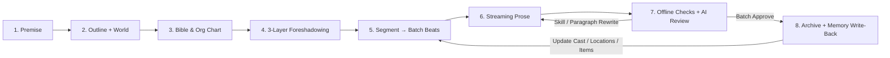

<div align="center">


<h1>Novel Studio · A Writing Workbench for Long-Form Fiction</h1>

<p>
  <strong>An open-source AI writing workbench built for long-form serials</strong><br />
  Turn <em>premise → outline → world bible → foreshadowing → beat sheets → prose → review → archive → memory write-back</em> into a <strong>reversible, ledger-driven production line</strong> — not just another chat box.
</p>

<p>
  <a href="README.md">简体中文</a> ·
  <a href="README.en.md"><strong>English</strong></a>
</p>

<p>
  <a href="LICENSE"></a>
  
  
  
  
  <a href="https://github.com/chenxy1021/novel-studio-web/stargazers"></a>
</p>

<p>
  <a href="#-screenshots">Screenshots</a> ·
  <a href="#-why-not-another-chat-box">Why Novel Studio</a> ·
  <a href="#-quick-start">Quick Start</a> ·
  <a href="#-core-mechanics">Core Mechanics</a> ·
  <a href="#-reference-pack--model-routing">Model Setup</a>
</p>

<br />


<sub>Captured with the fictional demo book <em>Mist City Night Mail</em> (雾城夜邮) · Light, Dark &amp; System themes</sub>

</div>

---

## ✨ Why Not Another Chat Box?

The real bottleneck in writing a 100-chapter serial with LLMs isn't generating 2,000 words — it's **continuity drift, dead characters walking back on stage, repetitive AI clichés, dropped foreshadowing, and broken context the moment you edit a chapter by hand**.

| Common AI Fiction Pain Point | Plain Chat UI / Prompt Wrappers | How Novel Studio Solves It |
|---|---|---|
| **Continuity drift & retcons** | Stuffing everything into one window and hoping the model remembers | **Computed continuity ledgers**: three-layer character state, location trails, item transfer chains, info gaps, and departed cast |
| **AI clichés & flat rewrites** | Vague "write like a human" prompts | **Two-layer review + anti-flattening guard**: offline checks for 13 cliché patterns, cross-chapter repeats & rhythm variance; flat rewrites are rejected |
| **Dropped foreshadowing** | Threads planted in ch. 3 and forgotten by ch. 40 | **Foreshadowing gate + Chapter Graph**: prose generation requires active threads; core/volume/plot layers tracked with due-chapter reminders |
| **Broken state after manual edits** | Editing prose externally leaves AI memory stale | **Markdown-first + fingerprint sync**: `sha256` detects external edits and re-syncs chapter memory and character states on demand |
| **Context bloat & dilution** | Long bibles drown out scene instructions | **Entity resolution + stage budgets**: only relevant entities expand in full; overflow collapses into a roster and prose stage tightens background budgets |

---

## 📸 Screenshots

> Captured with the completely fictional demo book *Mist City Night Mail* (`雾城夜邮`). Everything runs locally with zero cloud lock-in.

<table>
  <tr>
    <td width="50%" align="center">
      
      <br />
      <strong>Chapter Review · Offline Checkup &amp; Paragraph Rewrite</strong><br />
      <sub>Pinpoints AI tells to paragraph &amp; offset, with one-click paragraph rewrite, dismissible false positives, and 5-dimension aesthetic reviews</sub>
    </td>
    <td width="50%" align="center">
      
      <br />
      <strong>Outline · Chapter Graph (Foreshadowing &amp; Cast Arcs)</strong><br />
      <sub>Derived purely from existing ledgers: upper arcs show foreshadowing plant/payoff; lower arcs show shared cast within 10 chapters</sub>
    </td>
  </tr>
  <tr>
    <td colspan="2" align="center">
      
      <br />
      <strong>Memory View · Auto Write-Back Timeline &amp; Narrative Memory (Dark Theme)</strong><br />
      <sub>Automatically extracts in-story time, cast, events, and foreshadowing markers after each chapter, with deterministic keyword recall</sub>
    </td>
  </tr>
</table>

---

## 🔄 Production Pipeline



- **Prose always lives on disk as Markdown**: `chapters/NNN-title.md`, editable in Obsidian, Typora, or VS Code, with **one-click full-book TXT export** (`exports/`).
- **Structured ledgers live in SQLite**: shared across books via one domain layer.
- **Built-in safety nets**: up to 20 version snapshots per chapter in `chapters/.versions/NNN/`; full book snapshot to `data/deleted/` before deletion; rejected drafts remain restorable in Discarded.

---

## 🚀 Quick Start

### Requirements

- **Python ≥ 3.11** and **[uv](https://docs.astral.sh/uv/)**
- **Node.js ≥ 18** and **npm**
- Any **OpenAI-compatible API endpoint** (DeepSeek, OpenAI, OpenRouter, Ollama / vLLM, etc.)

### Launch in One Command

```bash
git clone https://github.com/chenxy1021/novel-studio-web.git
cd novel-studio-web

./scripts/dev.sh open     # starts API (8010) + Web (5180) and opens the browser
```

First run automatically executes `uv sync` and `npm install`. Configure your Base URL, prose model, and fast model in **Settings** and click **Test connection** (saved locally to gitignored `data/gateway.json`).

<details>
<summary><strong>Development &amp; test commands</strong></summary>

```bash
./scripts/dev.sh          # start API + Web in foreground, Ctrl-C stops both
./scripts/dev.sh status   # ports, health check, log locations
./scripts/dev.sh stop     # stop by port, including orphaned processes

make api                  # run FastAPI backend only (8010)
make web                  # run Vite frontend only (5180)
make test                 # run full pytest + vitest suite (100% offline mocks)
make build                # TypeScript typecheck + production bundle
```

</details>

---

## 🧠 Core Mechanics

### 1. Three-Layer Character State, Resurrection & Flashback Isolation
Character state is split into three non-overlapping layers:
- **Debut** (`appearanceStatus` + `firstChapter`): state at first prose appearance.
- **Current** (`status` + `statusAt` / `statusLog`): per-chapter ledger of what has actually happened in prose.
- **Exit & Ending** (`exitChapter` + `finalStatus`): distinguishes occurred exits from future outline plans (a character planned to die in ch. 76 still reads present in ch. 56).

Built for real serial-fiction edge cases:
- **Xianxia / Fantasy resurrection**: explicit revivals, rebirths, or body possessions with stated means and costs are excused from departed-character conflicts; departed cast named in the current chapter's beats or focus are flagged pre-write so the model explains their return clearly.
- **Flashback isolation**: full flashback chapters (`isFlashback: true`) and partial flashback moves/state entries (`flashback: true`) never overwrite current-timeline debuts, locations, or life/death state. When the previous chapter is a flashback, the "previous chapter ending" context automatically links back to the most recent mainline chapter.

### 2. Two-Layer Review, 5 Aesthetic Dimensions & Anti-Flattening Guard
- **Offline deterministic checks (0 tokens)**: word count, platform formatting, 13 Chinese AI-cliché categories (with paragraph & character offsets), 7 chapter-end hook patterns, hard-rule collisions, departed-character resurrections, cross-chapter 6-char repeats, rhythm burstiness, and beat completeness. False positives can be dismissed per item.
- **AI semantic re-check**: judges a fixed checklist item by item (beats, foreshadowing, settings, character state, POV) and requires verbatim quotes to fail an item.
- **5 aesthetic dimensions**: scores wording, rhythm, dialogue, imagery, and emotion (1–5) with verbatim 8–30 char evidence and actionable fixes — advisory only, never blocks archiving.
- **Skill / paragraph rewrite**: re-runs hard checks before writing to disk; if a rewrite drops below minimum length, breaks a rule, or flattens rhythm/dialogue/lexical diversity (`flattening`), the write is rejected untouched.

### 3. Four-Level World Rules & Organization Hierarchy
- **Four rule levels**: `Iron law` (cannot break, only circumvent), `Contract` (breakable with immediate explicit cost), `Convention` (social cost), and `Rumor` (breaking it reveals truth), each with `cost`, `boundary`, and `enforcer`.
- **Factions / Organizations / Careers**: cleanly separated so factions own rivalries and hidden rules, organizations (`bible.organizations`) own reporting lines, and careers (`bible.careers`) own promotion ladders — auto-organized from existing settings without overwriting author edits.

### 4. Rolling Plan, Chapter Graph & Manual-Edit Sync
- **Rolling plan**: when writing passes the last planned volume, appends the next volume outline and batch beats from your compass (`compassText`), book outline, and recent 6 chapter memories without touching existing chapters.
- **Chapter graph & related chapters**: deterministic scoring across cast overlap, foreshadowing, and state continuity builds both the visual graph and far-chapter recommendations.
- **Manual-edit sync**: detects `edited`, `untracked`, and `memory-stale` chapters by `sha256` fingerprint and runs `undo → re-extract memory → reapply` per chapter.

---

## 📦 Reference Pack & Model Routing

- **Pre-write entity resolution & stage budgets**: resolves characters, places, items, factions, terms, and threads before generation (individually excludable in the panel); overflow collapses into a one-line roster instead of silently dropping names. During prose generation, background-heavy sections (`volume-outline`, `foreshadow-open`, `volume-memory`, `society`, `history`) automatically tighten their budgets to prevent attention dilution.
- **End-to-end SSE streaming**: premise, outline, bible, foreshadowing, beats, prose, and rewrites all stream with stage progress, reasoning traces, and `runId` concurrency protection.
- **Stage-based reasoning effort**: `high` for blueprint/concepts/settings, `medium` for beats/foreshadowing/prose/rewrite, `none` for memory extraction (overridable via `NOVEL_STUDIO_REASONING`). Non-streaming prose supports `candidates: 1–3` draft selection.

---

## 📚 Full Reference (Expandable)

<details>
<summary><strong>1. All 14 Workbench Pages</strong></summary>

| Group | Pages |
|---|---|
| **Workbench** | **Today** (action queue), **Start** (setup pipeline), **Style** (book defaults + author presets) |
| **Writing** | **Progress** (per-chapter review/checks/rewrite/archive), **Discarded** (old & rejected drafts) |
| **Planning** | **Outline** (structure/world/map/chapter graph + rolling plan), **Beats** (segment plan + references), **Foreshadowing** |
| **Reference** | **Characters** (cards/matrix/graph/location trail), **Organizations** (org chart/career ladders), **Memory** (timeline/recap/search), **Bible** (rules/world depth/factions/locations/items/info gaps) |
| **System** | **Settings** (appearance/auto-archive/models/repair/usage) |

</details>

<details>
<summary><strong>2. Storage &amp; Directory Layout</strong></summary>

| Data | Location |
|---|---|
| Book settings, bible, outlines, segments, foreshadowing, memory, timeline | SQLite: `data/studio.db` |
| Prose | Book directory `chapters/NNN-title.md` |
| Chapter index &amp; fingerprints | `chapters/index.json` (with prose `sha256`) |
| Prose version history | `chapters/.versions/NNN/*.md` (latest 20 per chapter) |
| Aesthetic reviews / TXT exports | `ledger/aesthetic.jsonl` / `exports/title-time.txt` |
| Prompt modules | `prompts/*.md` (overridable per book) |
| Pre-delete snapshots | `data/deleted/` |

```text
backend/
  app/api/          # FastAPI routers: books / studio / review / memory / style / extras / settings
  app/core/         # Data paths, book roots, deletion snapshots
  app/store/        # File + SQLite compatibility layer (atomic writes & locks)
  app/domain/       # Domain logic: writing, review, memory, continuity, quality, metrics, references…
  app/llm/          # OpenAI-compatible client, settings, stage routing
  tests/            # Offline pytest suite with golden comparisons
frontend/
  src/views/        # 14 pages
  src/components/   # WritePanel, ChapterCheckPanel, Memory, ChapterGraph, CommandPalette…
  src/stores/       # Pinia stores
  src/design/       # light-dark() theme tokens & UI components
prompts/            # Reusable writing-craft prompt modules
```

</details>

<details>
<summary><strong>3. Environment Variables</strong></summary>

| Variable | Purpose |
|---|---|
| `NOVEL_STUDIO_HOME` | System data dir (SQLite / `gateway.json` / `recent.json`), default `<repo>/data` |
| `DSH_NOVEL_HOME` | Book shelf root, default `~/Desktop/mine/xiaoshuo` |
| `DSH_NOVEL_ALLOWED_ROOTS` | Extra allowed project roots (`:` separated) |
| `DSH_NOVEL_DB` | Override SQLite file path |
| `DSH_NOVEL_RECENT_FILE` | Override recent books list file |
| `DSH_NOVEL_AUTO_MEMORY` | Set `0` to disable automatic memory write-back |
| `NOVEL_STUDIO_SNAPSHOT_DIR` | Pre-delete snapshot directory, default `<data>/deleted` |
| `NOVEL_STUDIO_REASONING` | Per-stage reasoning effort override JSON (e.g. `'{"prose":"high"}'`) |

</details>

<details>
<summary><strong>4. Keyboard Shortcuts</strong></summary>

- `⌘K` / `Ctrl K` or `/`: Command palette (search pages, chapters, characters, threads, actions)
- `W`: Open write panel · `T`: Toggle light/dark theme · `?`: All shortcuts
- `G` then `H/P/X/O/D/F/M/W/C/G/S/,`: Jump to page (second `G` is Organizations)
- Progress page: `J/K` navigate, `Space` select, `↵` expand/archive, `R` reject, `B` batch check

</details>

---

## 📄 License

Licensed under [AGPL-3.0](LICENSE). You may use, modify, and distribute this project; if you offer a modified version as a network service, you must make the source code available under the same license.

If this workbench helps your writing or AI storytelling engineering, consider giving it a ⭐ **Star**!
